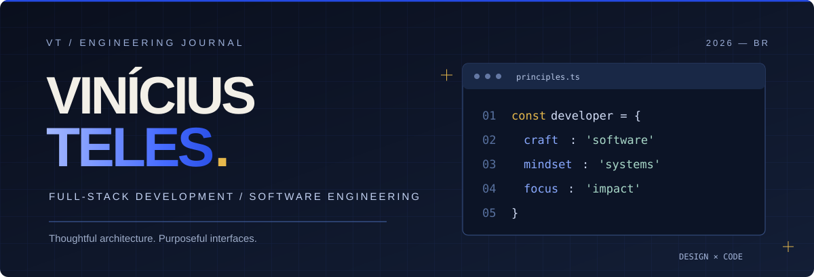

 

### ENGINEERING IDEAS INTO DIGITAL EXPERIENCES.

**Full-Stack Development · Software Engineering · Creative Technology**

 

  

&nbsp;

  

 

BASED IN BRAZIL · BUILDING FOR THE WEB

---

## 01 / THE DEVELOPER

### Software is more than code.

Sou **Vinícius Teles**, estudante de Ciência da Computação e desenvolvedor focado na construção de aplicações modernas, funcionais e bem estruturadas.

Meu interesse está na interseção entre **engenharia de software, desenvolvimento full-stack e experiência do usuário**.

Busco transformar ideias em produtos digitais, trabalhando desde a organização da arquitetura até a implementação de interfaces intuitivas.

Atualmente, estou desenvolvendo o **Nexus Academy**, explorando novas tecnologias e aprofundando meus conhecimentos em aplicações web e experiências interativas.

 

<table>
<tr>
<td width="50%" valign="top">

### CURRENTLY BUILDING

**Nexus Academy**

Plataforma full-stack de gerenciamento acadêmico.

`Django` · `Next.js` · `PostgreSQL`

</td>
<td width="50%" valign="top">

### CURRENTLY EXPLORING

**Creative Development**

Experiências web com animações avançadas e interatividade.

`GSAP` · `Three.js` · `WebGL`

</td>
</tr>
</table>

---

## 02 / THE TOOLKIT

### TECHNOLOGIES BEHIND THE WORK.

Uma seleção das ferramentas que utilizo e estudo durante meu desenvolvimento profissional.

 

**FRONTEND & INTERFACE**

  

  

**BACKEND & DATABASE**

  

  

**TOOLS & WORKFLOW**

  

  

**EXPLORING NEXT**

  

  

Technology is a tool. Building meaningful solutions is the goal.

---

## 03 / SELECTED WORK

### PRODUCTS, SYSTEMS & EXPERIMENTS.

**Real projects. Practical engineering. Thoughtful experiences.**

Projetos que representam minha evolução como desenvolvedor.

 

<table>
<tr>
<td width="50%" valign="top" align="center">

 

<h2>NEXUS ACADEMY</h2>

<strong>Academic Management Platform</strong>

  

 

  

Plataforma acadêmica para centralizar o gerenciamento de alunos, professores, turmas, disciplinas e processos educacionais.

  

<strong>ENGINEERING STACK</strong>

  

  

  

  

</td>
<td width="50%" valign="top" align="center">

 

<h2>FINTRACK</h2>

<strong>Personal Finance Dashboard</strong>

  

 

  

Aplicação web para organização de finanças pessoais, acompanhamento de transações e visualização de receitas e despesas.

  

<strong>ENGINEERING STACK</strong>

  

  

  

  

</td>
</tr>
</table>

 

---

## 04 / ENGINEERING MINDSET

### HOW I APPROACH SOFTWARE.

*Thoughtful engineering creates better digital products.*

 

<table>
<tr>
<td width="33%" valign="top" align="center">

### 01 / STRUCTURE

  

**Architecture & Organization**

Responsabilidades claras, código organizado e soluções que possam evoluir.

</td>
<td width="33%" valign="top" align="center">

### 02 / EXPERIENCE

  

**User-Centered Thinking**

Interfaces intuitivas, consistentes e projetadas para pessoas reais.

</td>
<td width="33%" valign="top" align="center">

### 03 / EVOLUTION

  

**Continuous Improvement**

Experimentação, aprendizado e evolução constante das soluções.

</td>
</tr>
</table>

---

## 05 / DEVELOPMENT ACTIVITY

### MY DEVELOPMENT JOURNEY.

**Code. Experiment. Improve. Repeat.**

 

  

 

Public GitHub activity · Statistics supplied by third-party services.

---

## 06 / LET'S CONNECT

 

### HAVE SOMETHING IN MIND?

## LET'S BUILD SOMETHING REMARKABLE.

**Great digital experiences begin with thoughtful engineering.**

Aberto a oportunidades profissionais, colaborações e conexões com pessoas apaixonadas por tecnologia.

  

&nbsp;

&nbsp;

   

**CODE WITH PURPOSE. DESIGN WITH INTENTION.**

  

VINÍCIUS TELES © 2026

 

BUILT WITH CURIOSITY. REFINED THROUGH PRACTICE.

